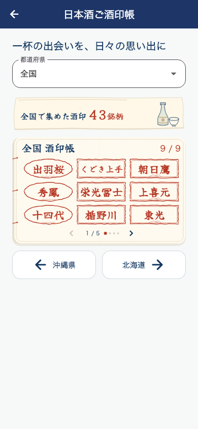
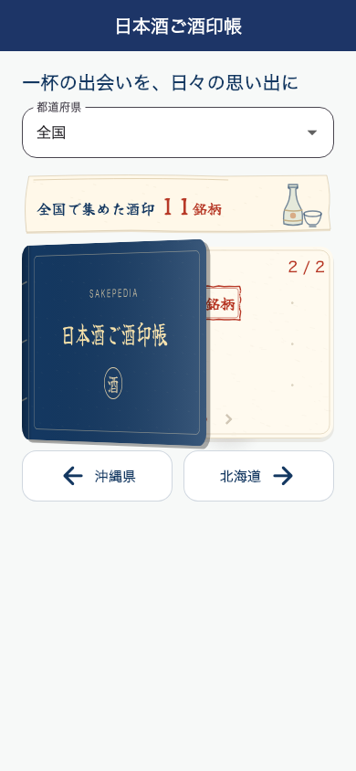
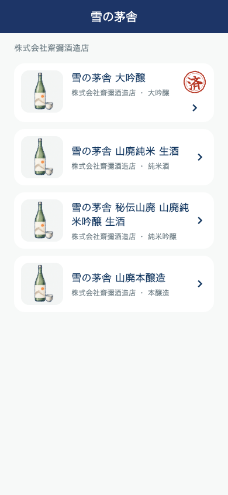
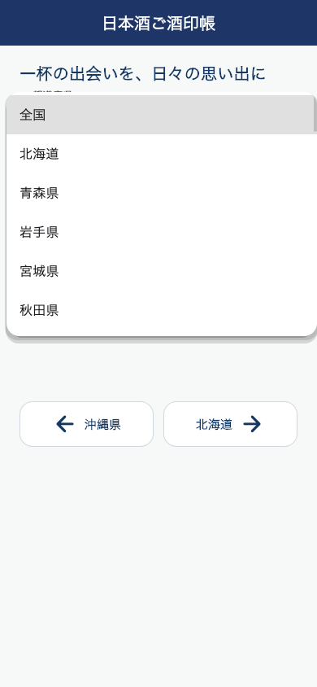

# ホームの酒印帳プレビューを9銘柄に制限

ホームは帳面をタップして専用ページを開く入口なので、全件分の銘柄情報を取得せず、県コード順・既存カタログ順で最初の9銘柄が揃った時点で取得を終了する。同じ応答に10件以上含まれる場合も表示用には9件だけ保持する。

- 帳面外の「全国で集めた酒印 ○銘柄」を削除。
- 右上の「9 / 9」を「現在○銘柄」に変更。数は押印済み銘柄IDの重複除外総数で、表示件数ではない。
- ホームの帳面はページ番号・矢印・ドットを表示しない。
- 押印なしの山口県プレビューも先頭9件・「現在0銘柄」。
- 専用ページの全件取得、ページ送り、県の選択、集計表示は維持。
- 意図的に取得しない10件目以降を「取得できなかった銘柄」として警告しない。

## 検証

関連ウィジェットテスト30件成功（酒印帳、開く動作、取得アニメーション）。43銘柄・2県のfixtureでは、従来の全件取得3リクエストに対し、ホームは最初の1リクエストで終了。タップ後の専用ページでは追加の3リクエストで全43銘柄とページ送りを確認。実環境の時間短縮は未計測。

同じカタログのpreview切替時は読み直し、全件表示が9件で止まらないことを確認。既存の通信失敗・再試行、記録変更、県変更、画面遷移のテストも成功。

`flutter analyze`: 全体418件の指摘、error 0。変更したDartファイルへの指摘なし。

この変更のiOSアップロードは未実施。

## 全国を含む都道府県の循環移動

専用ページの帳面下の左右ボタンを全国でも表示する。「全国 → 北海道（1）→ … → 沖縄県（47）→ 全国」の順に循環し、逆方向にも移動できる。全国では左が沖縄県、右が北海道。移動時は既存の県選択・前回の県の保存処理を利用する。

追加後の関連テスト31件成功。320px幅・文字倍率1.5でも、全国→沖縄→全国→北海道→全国の両方向と、青森・鹿児島の通常移動、選択欄・保存値の更新を確認。押印済み0件でも移動できる。静的解析は引き続き418件、error 0、変更ファイルの指摘なし。

## 移動時にも帳面を開く

専用ページでは、都道府県の左右移動・選択欄での変更、および帳面内の矢印・横スライドのページ変更時に、初回と同じ表紙を開く300msの動作を自動再生する。操作後に表紙をもう一度タップする必要はない。

ページの実際の変更通知を利用するため、データ取得完了だけでは再生せず、表示ページや取得済みカタログも維持する。連続移動では前のアニメーションを中断して最新の移動を再生し、破棄時の処理も確認。モーション低減設定では回転せず即座に開く。

関連テスト33件成功。全国・県それぞれの帳面の矢印、全国の横スライド、県の循環移動時の自動再生、再生中の誤タップ防止、連続移動、画面を閉じる操作、低減設定を検証。静的解析は418件、error 0、変更ファイルへの指摘なし。iOSアップロード未実施。

## 記録済み商品を先頭にし、県選択メニューを小さくする

銘柄の商品一覧は「済」の付いた商品を先頭にまとめる。照合済みの銘柄・正規商品IDで個人記録をまとめ、カタログの後続ページにある商品も記録の内容で先に表示する。一覧を追加取得したら同じIDを重複させずカタログの名称・画像等を優先。未記録商品どうしの既存の順序とページ送りは維持し、全ページの事前取得は行わない。

保存だけ・ラベル撮影だけを「済」にしない。記録変更やアカウント切替に追従し、カタログ未取得の個人記録が前アカウントから残らないことを確認。銘柄照合が未確認の商品を名前の類似だけで先頭へ混ぜない。

都道府県ドロップダウンは画面高の40%・最大300ptまで。選択肢のタップ領域と全47県＋全国、スクロール、選択の記憶を維持する。

関連テスト52件成功（記録済みスタンプ、ブランド別集計、酒印帳、地図、開く動作、取得アニメーション）。後続ページの記録の先行表示、追加取得と再試行、同一IDの重複除外、記録解除・アカウント変更、別銘柄の除外を確認。390×844と320×568・文字倍率1.5でメニューの実際の高さを確認し、沖縄と全国をスクロールして選択できることも検証。静的解析418件、error 0、変更ファイルへの指摘なし。iOSアップロード未実施。

