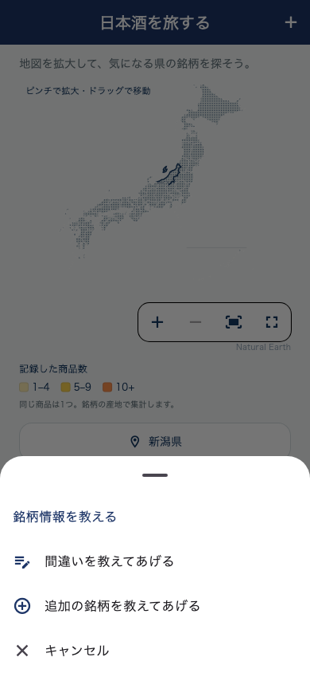
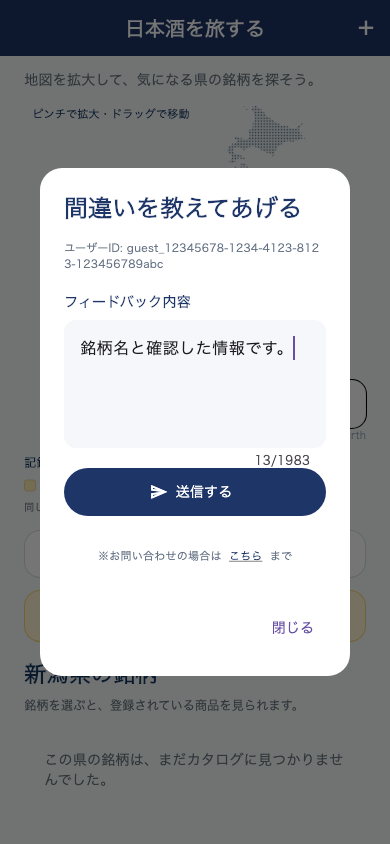

# 日本地図の銘柄情報フィードバック

「日本酒を旅する」の右上に白い＋ボタンを追加。日本酒詳細の操作と同じ下から開くメニューで次の2項目を表示する。

- 間違いを教えてあげる
- 追加の銘柄を教えてあげる

選択するとマイページと同じフィードバック入力画面を開く。既存AppFeedbackIdentity / AppFeedbackRepository / POST /api/app-feedbackを再利用し、ログイン済みはアカウントのユーザーID、未ログインは既存の永続ゲストIDを使う。ユーザーID表示、入力必須、送信中の操作抑止、成功表示、失敗時の入力保持と再送、問い合わせ導線を共用。

ユーザーの修正指示に従い、選択都道府県の名前・コードは自動付加しない。送信本文には「日本酒を旅する：間違いの報告」または「日本酒を旅する：追加の銘柄」の見出しと入力本文だけを入れ、既存のアプリ版・プラットフォーム・受付IDを同送する。本文見出しの長さを入力上限から差し引き、既存APIの2000文字以内へ収める。一般フィードバックは従来通り見出しなし・上限2000文字。

## 検証

- フィードバック6件：両メニュー×アカウント/ゲスト、県を付加しない送信データ、空入力送信禁止、成功表示、失敗再送の本文/受付ID一致、キャンセル未送信、一般フィードバックの互換性。
- 地図・ホーム・県別記録・チュートリアルも含め30件成功。
- 全体静的解析エラー0、既存警告・情報418件、新規指摘なし。
- HTTPモックで送信内容とURLを確認。実際のフィードバック通知は送っていない。バックエンド変更・配備・iOS/Android配信・版番号変更なし。
- 同じPR83へ追加。

以下はテスト用ID・本文を使った表示例。

