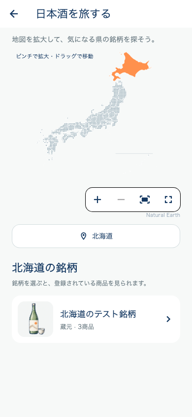
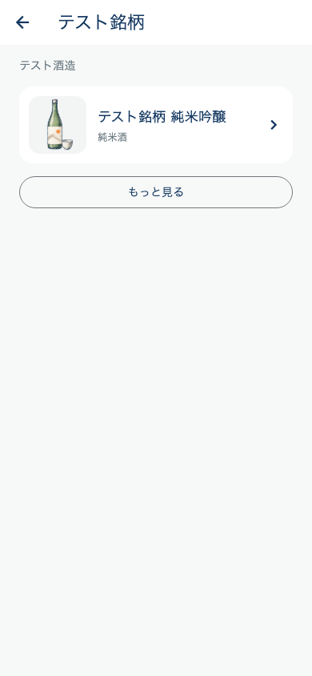
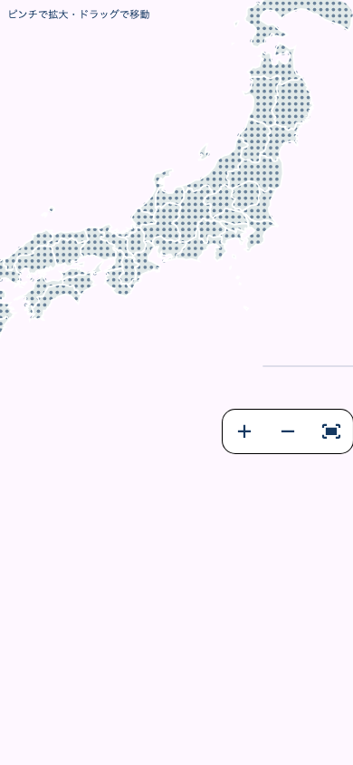

# 日本地図の拡大と銘柄・商品ブラウザー

2026-10-29の地図改善依頼に対応。実装・ローカル検証済み、サーバー配備・iOS / Android配信は未実施。版番号は5.0.36+166のまま。

## 画面と選択

- ホームの地図・入口ボタンから開く産地画面に、ピンチ拡大（最大6倍）、拡大/縮小、全体表示、全画面表示を追加。ダブルタップでも拡大を切り替える。
- 拡大後はドラッグで移動し、その見た目に対応する都道府県をタップできる。県一覧からの選択も維持。操作ボタンを地図の外へ配置し、県のタップを妨げない。
- 県を選ぶと銘柄一覧を表示。カタログの銘柄IDで区別し、蔵元名と商品数も表示。同名でも異なる銘柄IDをまとめない。
- 銘柄を選ぶとその銘柄の商品一覧、その商品を選ぶと既存の商品詳細へ進む。
- 銘柄にはその銘柄内の代表商品の画像を使い、商品には商品自身の画像を使う。サムネイル優先、失敗時はメイン画像、その画像もなければ同じローカル手書きイラスト。公式ロゴの表示とは呼ばない。
- 初回は50銘柄/商品まで。もっと見るで続きを取得できるため、50商品だけから銘柄を推測して列挙しない。

## 通信とデータ

バックエンド `codex/prefecture-brand-catalog` の新しい読取専用APIが必要。既存のdiscover APIは変更しない。

- GET /api/sakes/prefectures/:code/brands?limit=50&afterId=...
- GET /api/sakes/brands/:brandId/products?limit=50&beforeId=...

有効マスターのみを対象とし、重複元・却下・非表示の商品を除外。既存の公開許可済み画像サービスで補完する。DB変更・マイグレーション・シード・AI解析起動・個人画像の非公開設定変更はなし。

画面で県を切り替えた後の古い応答を表示しない。初回取得を県ごとにキャッシュ。失敗時は再取得でき、追加ページの失敗時は取得済み項目を保持する。エラーと未収録を分け、不正な形式・逆向きカーソルもエラーにする。

## 検証

- Flutter関連22件成功（ホーム既存表示、地図47県、県切替/キャッシュ/エラー、文字1.5倍の小画面、別銘柄ID、商品ページ追加、拡大後の正しい県選択、全画面からの選択、ピンチ/移動、NoImage/画像取得失敗、実際のリクエストURLとカーソル）。
- 全体analyzeはエラー0、既存警告・情報418件。変更ファイルでの指摘なし。
- バックエンドは旧admin凍結ガードを含むbuild成功、カタログAPIのDB/コントローラーテスト4件成功。
- 画像は[共通イラスト](../assets/images/sake_catalog_illustration.png)。built-in image_genで生成しプロジェクトへ保存。[最終生成指示と素材記録](data/sake_catalog_illustration_20261029.json)。
- 実機での操作感、本番APIとの接続は次の配信時に確認する。

## 画面例（テストデータ）

## 配信記録

実装時点の未配信状態は上記のとおり。以後の本番反映・iOS 5.0.37（167）の検証結果は[配信記録](RELEASE_167_IOS_JAPAN_MAP_20261029.md)を参照。
