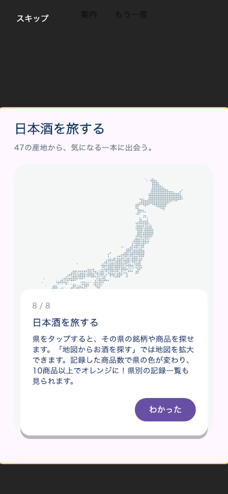

# 「日本酒を旅する」のホームチュートリアル

ホームのフォーカスガイドの最後、タイムラインの次へ8番目のステップとして追加。

- ホームの実際のJapanSakeSectionにGlobalKeyを付け、画面外のセクションを構築するまでスクロールしてから強調する。強調領域はスクロール表示範囲でクリップ。
- 県→銘柄・商品、詳細地図の拡大、記録した商品数による色付け（10商品以上でオレンジ）、県別記録一覧を紹介。
- 案内は他のホーム内セクションと同じ下部カード。最終ステップの「わかった」で完了。
- 初回案内とホームの「もう一度チュートリアルを見る」の双方に含める。既存の完了状態はリセットせず、完了済み利用者への自動再表示は増やさない。

案内が画面外でも最終ステップまで進み、8 / 8と本文が表示されること、完了状態保存、完了後の自動抑止、明示的な再表示とスキップをwidgetテストで確認。ガイドと既存ホーム関連6件成功。全体静的解析エラー0、既存警告・情報418件、新規指摘なし。

同じPR83に追加。配信・版番号・サーバー変更は行っていない。

以下はガイドの表示検証用画面（上部の案内起動ボタンはテスト用）。

## 配信結果

iOS 5.0.38（168）を2026-10-30 00:59 JSTにAppleへ送信済み。[送信結果と検証](RELEASE_168_IOS_SAKE_STAMP_BOOK_20261030.md)。
