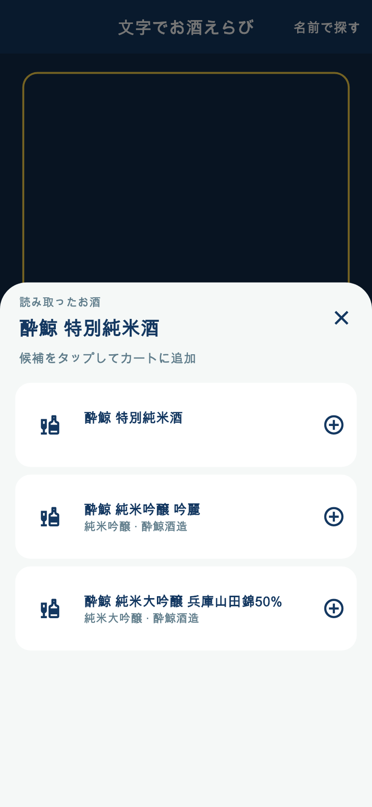
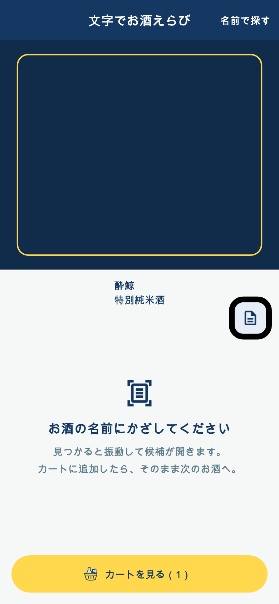

# 文字スキャンの候補シートと連続追加

2026-11-07。191の認識範囲補正を保持した上で、候補を下から開く操作へ変更。今回の変更は未配信。

## 操作

- 安定した文字からマスター候補が返った時に一度振動し、下から少し弾む候補シートを開く。候補カードの画像・名称・分類・蔵元・取得できたマッチ度の表示は維持。
- シートが開いた瞬間から閉じ終わるまでOCRの呼び出しを止め、処理中だったフレームの返却も採用しない。カメラ映像とプレビューは維持する。
- 右上×で未選択のまま閉じて認識を再開。遅れて返る検索が再度シートを開かないよう世代を無効化。同じ読み取り直後の開き直しも抑止し、別の名前・種類または空白を挟むと再び検出できる。
- 候補をタップして保存が成功したら振動し、シートを閉じてカートに入るアニメーションを表示。カート画面へ遷移せず認識を再開する。カートを見るボタンを明示的に押したときだけカートに戻る。
- 保存中の連打・×を抑止。重複・カート20件上限・遅延したプロフィールによる上書き防止を保持。画面を閉じた場合は飛翔アニメーションも破棄。端末の動きを減らす設定を尊重する。

## 読み取りと順序

- 「酔鯨」と次行の「特別純米酒」のように酒まで含む分類を認識名に連結し、シート上部に表示。分類先行・空白のない表記・棚札の都道府県等も考慮する。
- 名称と分類を含む検索に加え、銘柄だけのマスター検索を必ず残す。完全一致・種類一致の商品を優先するが、種類の違う取得済み候補も除外しない。
- クライアントの候補20件切り捨てを撤去。スキャナーは既存APIの最大許容値50件を各検索で要求し、得られたマスター候補の和集合を保持する（ID重複のみ統合）。API自体の1検索50件制限は変更していない。銘柄の全登録件数がそれを超える場合、全件取得を保証するものではない。
- 個別商品・銘柄に固定した条件はない。端末内OCRと既存APIのみを使用し、画像送信・AI解析・サーバー変更は追加していない。

## 検証

関連29テスト成功。最終の操作・検索15テストも再実行して成功。flutter analyzeはエラーなし、既存警告・情報あり。git diff --check成功。

確認項目: シート内と閉じる途中にOCR呼び出しが増えないこと、×で保存せず再開すること、検出と追加の振動回数、追加時の飛翔表示、カート画面に遷移せず2件を連続追加すること、文字と種類の見出し、種類一致の優先、20件を超える異種候補の保持、古い応答の抑止、既存検索・比較・カート保存の回帰。

実装プレビューはウィジェットテストのカメラ代替表示と候補データを使用。端末の実際の振動感、店内の手持ち認識精度は未確認。

