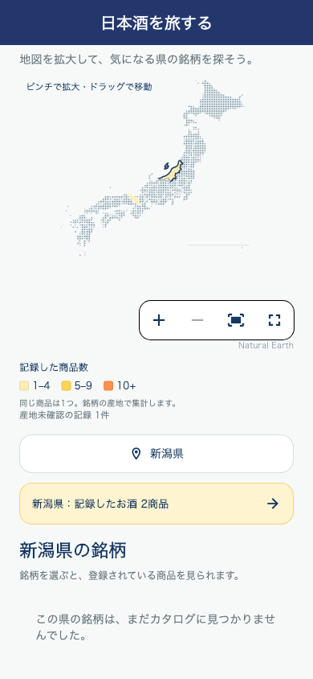
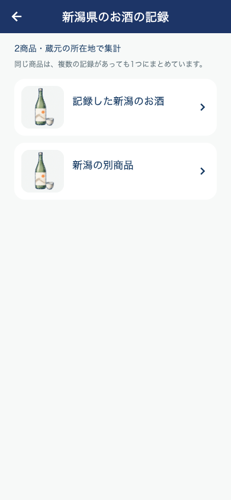

# 日本地図の見出し統一と閲覧履歴

地図・県の全画面選択・県別記録一覧・銘柄の商品一覧を共通のPrimaryAppBarへ変更。他の一覧と同じ紺色背景、中央揃え、白い20pt太字を使う。

地図の銘柄→商品一覧から開く詳細と、県別の記録一覧から開く詳細で、既存のrecordRecentViewを有効化。原因は地図からの遷移でこの指定がなかったこと。既存の詳細取得処理が成功したときにだけRecentSakeHistoryへ商品を追加する。県・銘柄一覧だけの表示や詳細の取得失敗では追加しない。既存の端末保存・200商品上限・同一IDの再閲覧による更新をそのまま使用する。新しい保存酒や公開投稿は作らず、個人の感想を閲覧履歴へコピーしない。

SavedSakeDetailPage.forSakeには省略時falseの引数を加え、他の既存導線の挙動を保つ。

## 検証

- 地図・ホーム・県別記録・商品集計22件成功。
- 追加の詳細遷移4件成功：銘柄の商品一覧 / 県別記録一覧それぞれで成功と失敗を確認。成功時は詳細APIの正式な商品情報が履歴へ入り、履歴オブジェクトを新しく読み直しても保持。失敗時・一覧だけの表示では履歴は増えない。保存件数・個人メモ・保存IDを保全。
- 詳細画面全体も実行し、既存6件が失敗。変更前HEADの同テストファイルを別途実行し、同じ6件が失敗することを確認（評価カードの配置、公開評価入力、取得失敗表示、AI候補の保存、タイムライン共有2件）。本変更で件数は増えていない。
- 全体静的解析：エラー0、既存警告・情報418件。新規指摘なし。既存のsaved_sake_detail_page.dart内の指摘はそのまま。
- 版番号変更、iOS / Android配信、サーバー更新なし。前の県別記録ボタンと同じPR83にまとめる。

画面例はテストデータ。

## 配信結果

iOS 5.0.38（168）を2026-10-30 00:59 JSTにAppleへ送信済み。[送信結果と検証](RELEASE_168_IOS_SAKE_STAMP_BOOK_20261030.md)。
