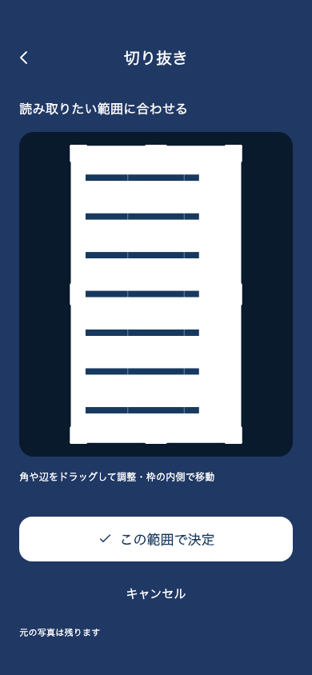
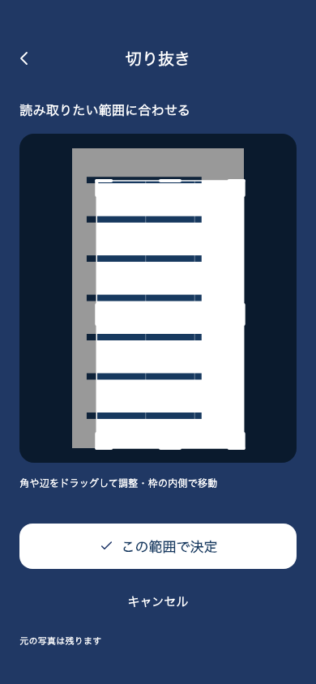

# メニュー写真の切り抜き操作改善（2026-10-29）

ユーザーの「配信まだよ」に従い、実装・検証のみ。iOS / Android のアーカイブ・送信・配信、バージョン変更は行っていない。アプリのバージョンは 5.0.35+165 のまま。

## 原因と変更

従来は四隅の44×44ptにしか操作領域がなく、ドラッグ認識開始までの移動しきい値があった。また、ドラッグ中は角を指の絶対位置へ合わせていたため、角の中心以外をつかむと枠がずれた。小さな1ptの移動に追従しないことを変更前のウィジェットテストで再現した。

- 角の判定を64×64ptに広げ、辺は線から24ptまで直接ドラッグ可能にした。
- 切り抜き領域では指の押下から直ちに移動を受け取り、ページのスクロールと競合しないようにした。
- つかんだ位置からの移動量を使い、角が指の位置へ飛ぶ動きをなくした。
- 内側のドラッグで選択範囲全体を移動できる。サイズと画像内の境界制限を維持する。
- 写真と操作枠を別の描画境界に分け、ドラッグごとにページ全体を再構築する処理をなくした。
- 辺のハンドル・三分割ガイド・範囲外の暗幕を追加し、日本語・英語の操作案内を更新した。

## 検証

`flutter test --no-pub test/presentation/menu_search test/localization_assets_test.dart`：27件成功。

新規5件で、縦ドラッグ中のスクロール抑止、1ptからの追従とつかんだ位置の維持、角の広い操作範囲と辺での調整、内側での移動と境界制限、実際の確定操作で選択どおりの寸法を保存し元画像を保全することを確認。

変更した画面・テスト2ファイルの `flutter analyze --no-pub`：指摘なし。`git diff --check`：成功。

画像は生成したテスト用メニューを使用。ユーザーの添付写真や個人情報は含まない。実機での体感・フレーム時間は未測定。

