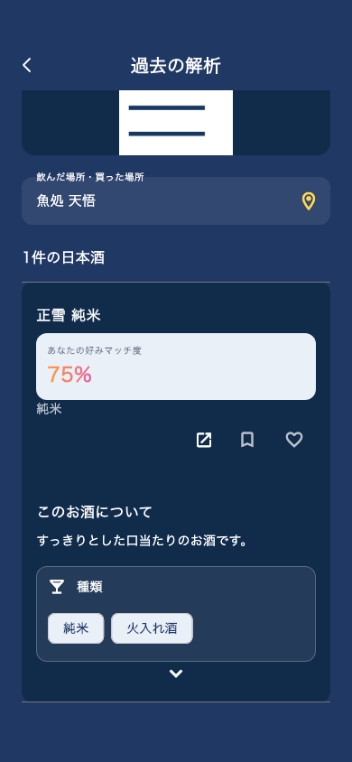

# メニュー解析の種類タグの可読性（2026-10-29）

解析結果を青背景へ変更した際、種類タグの文字も白へ変更しており、実際の淡いチップ背景と区別できなくなっていた。

解析直後・過去の解析の双方が使う `buildMenuSakeTypesRow` を修正。青背景用タグを不透明な淡色（#EAF0F7）と濃紺文字（#1D3567）の組み合わせに統一した。「種類」の見出し・蔵元の表示は従来どおり。

過去の解析の既存テストデータに種類を追加し、展開状態を画像で確認。関連するメニュー解析テスト26件成功。変更した表示部品とテストの静的解析は指摘なし。

ユーザーの配信保留を継続。バージョンは5.0.35+165のまま、iOS / Androidの配信・アップロードは実施していない。

