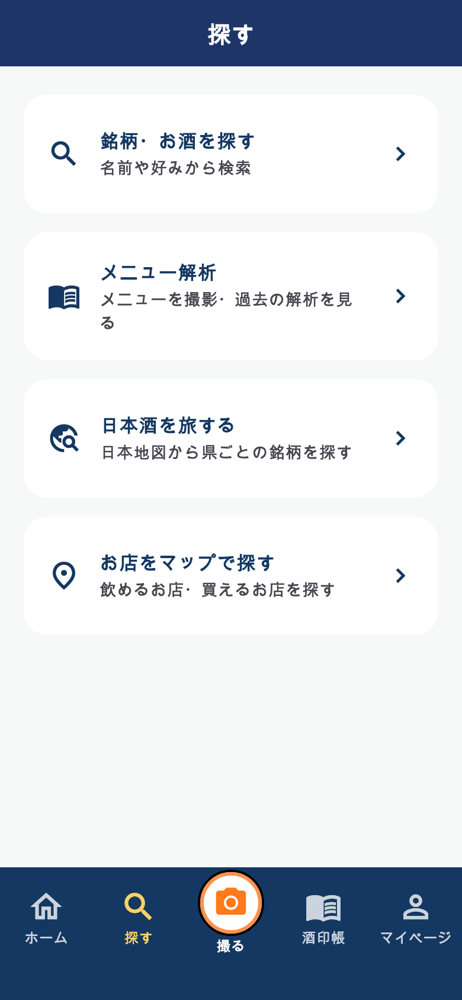

# ナビゲーション・ホーム配置変更

未配信。バージョンは174から変更していない。

- ボトムナビをホーム／探す／撮る／酒印帳／マイページへ変更。
- 探すに名前・条件検索、メニュー解析、日本地図、お店のマップへの既存導線を集約。
- 撮るでラベル撮影または既存のメニュー撮影画面を選択。撮影ボタンはナビの範囲内に収める。
- 旧メニュー・マップ・タイムラインの内部タブ番号を保持し、既存の結果表示・マイマップ・投稿一覧リンクを維持。
- 酒印帳は初回のタブ選択まで読み込みを遅らせ、タブ移動では状態を保持。アカウント変更時は作り直す。
- ホームは検索ヘッダー、最近調べたお酒、酒印帳、日本地図、おすすめ、タイムライン、お知らせバナーの順。内容・記録や酒印の取得条件は変更しない。
- チュートリアルのナビ説明を更新。

## 確認

320pt（文字1.3倍）と390ptのナビ・探す各入口のコールバック、カメラボタンの非重複を確認（2件）。ホーム4件、酒印帳21件、ガイド2件が成功、計29件。静的解析は既存418件、新規エラーなし。画面プレビューは実装のwidget描画（検証用日本語フォント）で、iOS実機確認は未実施。

