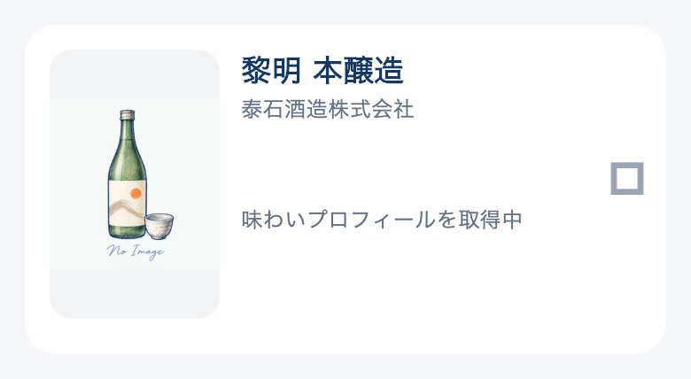

# 手描きのNo Image画像

既存の「日本酒を旅する」の酒瓶・おちょこイラストを元に、淡い青灰色の細い筆記体で `No Image` を下へ添えた。酒瓶のラベルには文字を追加しない。

- 制作：組み込みimage_genツールの編集モード。
- 参照：`assets/images/sake_catalog_illustration.png`。
- アプリの保存先：`assets/images/sake_placeholder.png`（旧画像の置換を依頼されたため同名で更新）。
- サーバーの保存先：バックエンドの `assets/noimage.png`。本番の静的画像をバックアップ後に置換し、公開HTTPSの取得内容が一致することを確認。プロセス再起動・DB変更なし。
- SHA-256：`0d094b26d8e0a205cfaf5ae03a1c846ce74e9618fd4e7062fab33bf61e77a34a`。
- サーバー記録：`logs/repairs/noimage-illustration-20261030/`。
- アプリ内の画像は未配信。No ImageのURL・画像なし・取得失敗で同じ端末内の画像を使用する。最近調べたお酒、同銘柄一覧、横並びカード、詳細、地図の代替画像は瓶と文字を切り取らない。
- 確認：画像なしとNo Image URL（クエリ付き含む）の実カード描画、既存の実画像優先の5テスト成功。画像読み込みと表示確認済み。

## 最終指示文

```text
Use case: precise-object-edit. This is the existing hand-drawn fallback bottle illustration for the SAKEPEDIA mobile app. Preserve the exact illustrated sake bottle and little ceramic ochoko cup, their navy pencil outlines, muted sage green watercolor, cream label with orange sun and waves, paper texture and extremely pale cool off-white background. Add only the exact English words "No Image" centered below the bottle and cup in a delicate, elegant, slightly handwritten cursive style. The lettering should be understated, soft desaturated blue-gray, clearly secondary to the illustration, no bold or oversized writing. Leave comfortable small margins on all sides. If needed, reduce the bottle and cup together a little to reserve a clean small caption strip along the bottom, without cropping or altering the bottle silhouette. Make a finished square app placeholder asset, balanced and legible when reduced to a small 96px thumbnail. No other letters or logos; do not write on the bottle label.
```


