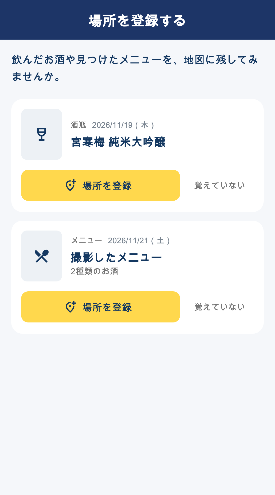

# 場所未登録一覧の表示調整

「覚えていない記録は、写真や履歴を残したまま一覧から外せます。」の説明文と右矢印を削除。カードの「酒瓶／メニュー」の横に記録日と曜日を11pxの控えめな色で表示する。酒瓶は既存saved_IDの保存時刻、メニューは既存dateを端末のローカル日時として使い、不明な日付は推測しない。

写真タップは場所選択ではなく黒背景の全画面プレビューを開く。ピンチで最大5倍まで拡大でき、右上の閉じるボタンで戻る。ローカル・URL・メニューのbase64画像を扱い、読めない画像はエラー表示で戻れる。場所選択は黄色い「場所を登録」ボタンからのみ開始する。

日付/曜日・説明と矢印の非表示・写真タップで場所選択を呼ばないこと・閉じた際の記録保全、小画面/文字拡大、既存の場所保存/取消/アカウント切替とレビュー依頼を含め、関連27テスト成功。静的解析エラー0。確認画像はサンプル記録（写真なし状態）でのレイアウト。既存の場所登録や忘れた記録の扱いは変更しない。

レビュー依頼と同じPR110へ個別コミットで追加。アプリ配布は未実施。
