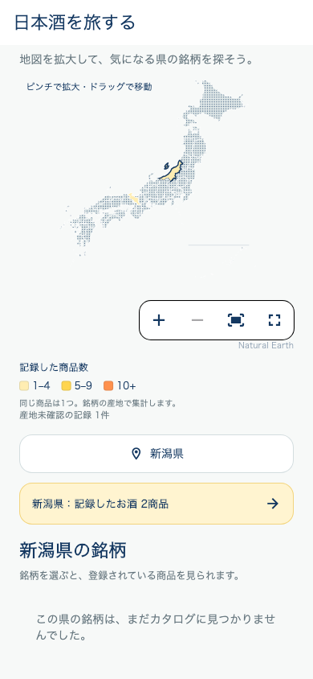
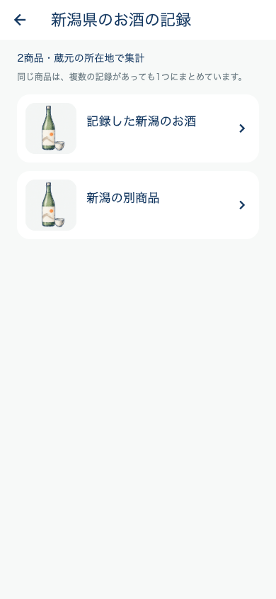

# 県別の記録一覧へのボタン

「日本酒を旅する」の選択県にある「○○県：記録したお酒 N商品」を、薄い黄色背景・右矢印付きの全幅ボタンへ変更。タップするとその県の記録済み商品の一覧へ進み、商品をタップすると既存の商品詳細を開く。

一覧と件数は地図の同じ集計から作る。記録のある商品だけを蔵元所在地で絞り、同一商品・統合元IDは1商品にまとめる。統合元の記録からも正規商品IDの詳細へ進む。飲んだ場所や記録内の旧県コードでは絞らない。現在読み込まれた保存一覧の先頭の記録を代表とし、保存データそのものは変更しない。

記録編集・削除・利用者切替で再集計。0件時の案内と通信失敗時の再試行を設け、通信失敗を0件扱いしない。写真欠落時は既存の共通手書きイラストを使用。

関連テスト18件成功（ボタン→一覧の遷移、矢印表示、県の絞り込み、商品と統合元IDの重複除外、正規IDへ遷移するデータ、保存元保全、記録なし除外、削除後の更新、失敗→再試行、既存地図操作）。全体静的解析はエラー0、既存警告・情報418件で変更ファイルの指摘なし。

iOS / Android配信、版番号変更、バックエンド更新は行っていない。

表示例はテスト用の記録で、実利用者データではない。

追加の見出し統一・閲覧履歴対応は[変更記録](MAP_TITLE_RECENT_HISTORY_20261030.md)を参照。
