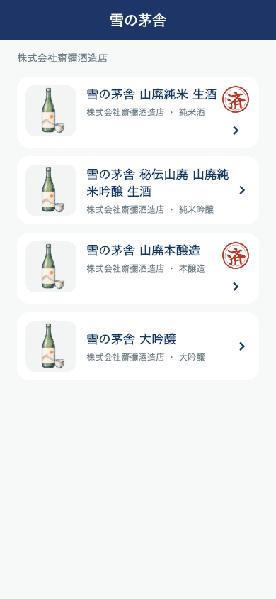
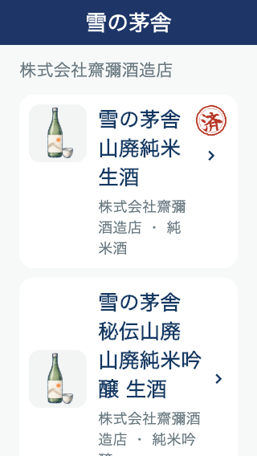

# 銘柄の商品一覧：記録済みの「済」朱印

「日本酒を旅する」で銘柄を選んだ先の商品一覧だけに追加。飲んだ記録がある商品のカード右上に、筆文字の「済」と朱色の二重丸を表示する。既存の酒印帳と同じ同梱書体を利用し、輪郭の揺れ・内周のかすれをCustomPainterで描画。写真・商品名・詳細へ進む矢印の操作を維持する。

判定は既存My Recordsと同じ共通関数。感想・場所・タグ・個人評価・追加写真などの記録が対象で、保存・自動解析のみでは付かない。商品IDの一致または産地照合APIで確認された統合先IDの一致だけを使い、同名・同銘柄から推測しない。産地照合が失敗しても直接IDが一致する記録には表示する。現在端末に読み込まれた自分の記録が対象。

記録の追加・削除・編集・アカウント切替に追従し、商品の取得済み一覧を再取得しない。記録・DBへの追加書込なし。他の一覧・県別の記録一覧・銘柄カードには追加していない。

関連36件と詳細→閲覧履歴4件成功。最後の配置調整後も対象2件成功。記録のみ・保存だけ・同銘柄の別商品・統合前ID・重複記録・編集/アカウント切替・照合API失敗・小画面320×568/文字1.5倍・読み上げを確認。通常390×844と小画面の実描画を保存。画像は検証用データであり実利用者の記録ではない。

全体静的解析エラー0、既存警告・情報418件、変更箇所の新規指摘なし。フォーマット・差分チェック成功。

版番号変更・iOS/Android配信なし。

## iOS配信

iOS 5.0.39（169）を2026-10-30 02:12 JSTにAppleへ送信済み。[送信結果と検証](RELEASE_169_IOS_SAKE_STAMP_HOME_20261030.md)。
