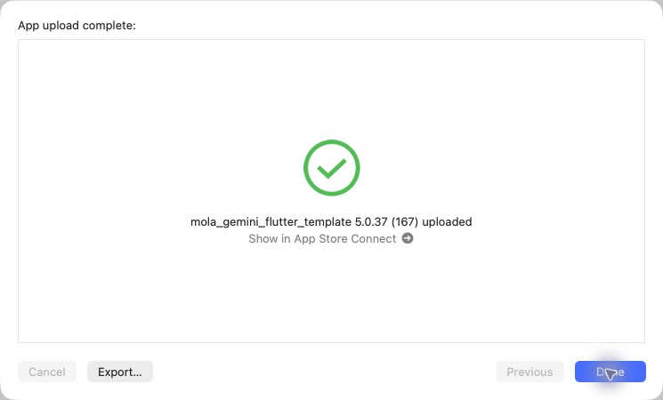

# iOS 5.0.37（167）日本地図・銘柄一覧・記録の色付け

2026-10-29の「配信」で本番反映とiOS送信を実施。Android配信とApp Store本番審査の提出は行っていない。

- 日本地図のピンチ拡大・移動・全画面表示、県→銘柄→商品→既存詳細の導線。銘柄は代表商品画像、商品は自身のサムネイルを表示し、欠落・画像取得失敗時は共通の手書き日本酒イラストを使う。
- 記録した異なる商品数で、1〜4商品は薄い黄色、5〜9商品は黄色、10商品以上はオレンジ。同一商品の繰り返し記録・統合元IDを重複除外。蔵元所在地を採用し、飲んだ場所や旧記録の県コードから推測しない。現時点で端末に読み込まれた自分の記録を対象とする。
- 詳細は[地図と銘柄一覧](JAPAN_SAKE_BRAND_BROWSER_20261029.md)、[記録の集計条件](SAKE_JOURNEY_PROGRESS_20261029.md)。

## サーバー反映

バックエンドPR56をmainへマージ。コミット `22b21c9e9c53e53b938b9ba246faadca7f988725`。[自動配備40895408947](https://github.com/MolasoftLLC/molasoft-ai-central/actions/runs/40895408947)はビルド・既存整合性検証・本番配備・HTTPSヘルスチェックまで成功。本番チェックアウトも同コミット、対象PM2のみonlineを確認。読み取りAPIの追加で、データ補完・Seeder・個人記録更新なし。

本番で北海道（男山13商品）、新潟（久保田17商品）、京都（月桂冠6商品）について県別銘柄・銘柄の商品・各続きページを確認。各県2商品の産地照合が一致、空配列と不正入力400も確認。久保田代表画像HEADは200/image/png。[実測データ](data/japan_map_production_20261029.json)。

## iOS検証と送信

- Flutter関連28件、バックエンド隔離DB/コントローラー6件成功。全体静的解析エラー0、既存警告・情報418件。変更ファイルでの指摘なし。旧admin凍結ガードを含むバックエンドbuild成功。
- 実装 `bfe1b83` / `af93e06`、版番号 `47046fe`、Flutter PR82のmainマージ `9a8eda7`。版番号以外の最終ソースで検証済み。
- production archive成功。5.0.37（167）、Bundle ID、非空かつ展開済みのMapsキー、production指定、地図データと新規イラスト同梱のハッシュ一致を確認。AOTバイナリは166と異なる。認証・秘密値は記録しない。
- CLI exportは既知のNo Accounts / Distribution証明書エラー。同じ完成済みアーカイブをOrganizerへ開き、通常のApp Store Connect（testing and release）を選択。最初の認証エラーは送信画面の閉じ直しで解消し、追加ログインなしで送信成功。
- **2026-10-29 23:57 JST、App upload complete / 5.0.37（167）uploaded、OrganizerのUploaded to Apple / Build Number 167を確認。**
- Apple処理完了・TestFlight利用可能状態は未確認。実機上の今回の操作感はユーザー確認待ち。元チェックアウトの未コミットiOS設定2ファイルはハッシュ一致で保全。サーバー側の無関係な未コミット資料・修復スクリプトも未変更。

[検証・送信データ](data/release_167_ios_20261029.json)

