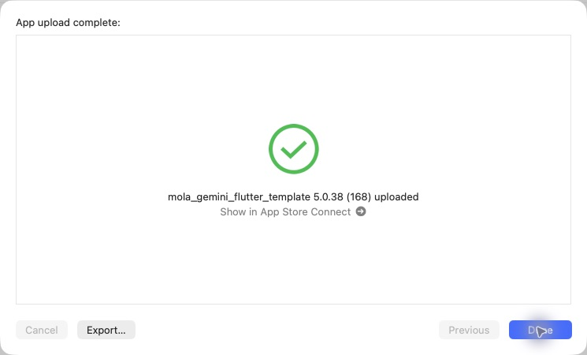

# iOS 5.0.38（168）酒印帳と日本酒を旅する改善

2026-10-30の「配信」で、iOSのみ通常のApp Store Connectへ送信。Android配信・App Store本番審査の提出・今回のサーバー配備は行っていない。

## 収録内容

- 「○○県の銘柄」直下に、和紙・筆文字・朱印の9銘柄ごとの酒印帳。横スワイプと矢印でページ移動し、印から銘柄の商品一覧を開く。既存の自分の記録条件と確定した銘柄IDで集計し、同銘柄の複数商品は1印。未確認の記録を推測で押印しない。詳細は[酒印帳](SAKE_STAMP_BOOK_20261030.md)。
- 県の記録商品数を矢印付きボタンにし、その県で記録した商品の一覧へ遷移。[記録一覧](PREFECTURE_RECORD_LIST_20261030.md)。
- 地図関連画面の見出しを既存の共通デザインに統一。商品詳細を正常に開いたら既存の「最近調べた酒」に追加。[見出し・閲覧履歴](MAP_TITLE_RECENT_HISTORY_20261030.md)。
- ホームのチュートリアルに「日本酒を旅する」を追加し、実際の該当箇所へ案内。[チュートリアル](JAPAN_SAKE_TUTORIAL_20261030.md)。
- 地図右上の＋から「間違いを教えてあげる」「追加の銘柄を教えてあげる」を開く。既存のレビューフィードバックと同じ識別・送信処理を利用し、県情報は自動付与しない。[報告メニュー](JAPAN_CATALOG_FEEDBACK_20261030.md)。

## 検証

関連34件、最終描画調整後の酒印帳・集計8件、詳細から閲覧履歴への連携4件が成功。全体静的解析エラー0、既存警告・情報418件、変更箇所の新規指摘なし。既存詳細テストの既知6件の失敗は変更前でも再現し、上記の閲覧履歴資料に記録。実通知を発生させるフィードバック送信テストは行わず、HTTPモックで検証。

production archive成功。版番号5.0.38（168）、Bundle ID、production指定、非空かつ展開済みのMapsキー、地図・汎用イラスト・筆文字フォントとライセンスの同梱ハッシュ、FontManifestを確認。AOTバイナリは167と異なる。フォントは約8MiB増、実行時ダウンロード不要。認証・秘密値は記録しない。

実装PR83をmainへマージ（`131f341b188c5d99e1b7f6541f6721e168881ac3`）、版番号コミット`9df2de2`。元チェックアウトの未コミットiOS設定2ファイルはハッシュ一致で保全。バックエンドと無関係な変更は未変更。

## Apple送信

CLI exportは既知のNo Accounts / Distribution証明書エラーだったため、完成済みアーカイブを再利用してOrganizerの通常App Store Connect（testing and release）を使用。初回の認証エラーは送信画面を開き直して解消し、追加ログイン不要で送信成功。

**2026-10-30 00:59 JST、App upload complete / 5.0.38（168）uploaded、およびOrganizerのUploaded to Apple / Build Number 168を確認。** TestFlight Internal Onlyは使用していない。Apple処理完了とTestFlight利用可能状態は未確認。

[検証・送信データ](data/release_168_ios_20261030.json)

