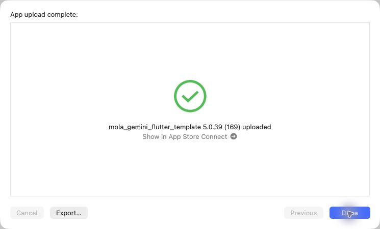

# iOS 5.0.39（169）ホームのご酒印帳と記録済みスタンプ

## 変更内容

- ホームの「日本酒を旅する」の上に「日本酒ご酒印帳」と既存デザインの9銘柄プレビューを追加。タップで専用ページへ。
- 専用ページで47都道府県の切り替え、9銘柄ずつのページ送り、酒印から銘柄別商品一覧への移動。
- 銘柄別商品一覧で、飲んだ記録のある商品の右上に丸い朱色の「済」スタンプを表示。保存だけでは押印しない。

## 検証とソース

関連38件成功。静的解析エラー0、変更箇所の新規指摘0（既存418件）。小画面320×568・文字1.5倍の実描画、通信エラーの再試行、記録編集・削除・アカウント切り替え、遅延応答も確認。PR84をmainへマージ（80103c9b71df825e109f0ab2e1a7563059520b99）。

production archive成功。アーカイブ内の5.0.39（169）、Bundle ID、非空・展開済みMapsキー、production指定、地図・汎用画像・筆文字フォントとライセンスの同梱ハッシュ、FontManifestを確認。AOTバイナリは168と異なる。元チェックアウトの未コミットiOS設定2ファイルはハッシュ一致で保全。秘密値は出力・記録しない。

## Apple送信

CLI exportの既知のNo Accounts / Distribution証明書エラー後、同じ完成済みアーカイブをOrganizerの通常App Store Connect（testing and release）で送信。最初の認証エラーは送信画面を開き直して解消し、追加ログインなしで成功。

**2026-10-30 02:12 JST、App upload complete / 5.0.39（169）uploaded、およびOrganizerのUploaded to Apple / Build Number 169を確認。** Internal Onlyは使用していない。Apple処理完了・TestFlight利用可能状態は未確認。本番審査には提出していない。Androidとサーバーの配備は行っていない。

[検証・送信データ](data/release_169_ios_20261030.json)

