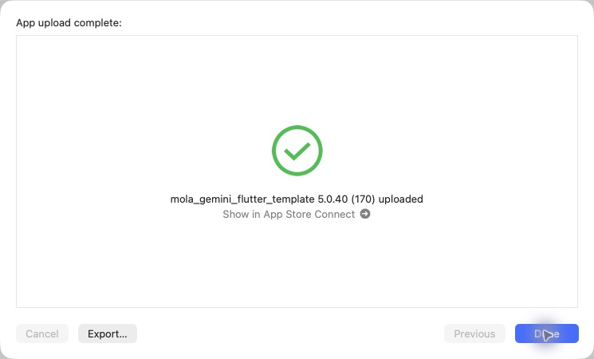

# iOS 5.0.40（170）酒印帳の使いやすさと押印デモ

## 変更内容

- 酒印帳の大きさをホーム・日本酒を旅するの表示に統一し、専用ページの長い説明と地図用凡例を削除。
- 酒印帳の下に太めの左右矢印と隣県名を追加。都道府県コード01〜47順で移動し、端では無効化。
- 「〇〇県で集めた酒印 N銘柄」を手書き風の和紙・お酒のイラスト背景へ変更。筆文字、朱色の集計数、小画面・文字拡大に対応。
- 押印済みだけ表示、全国の収集銘柄数、最後に開いた都道府県の記憶。
- ホームのデモボタンから押印アニメーションを再生。デモは記録・押印状態を変更しない。

## 検証とソース

関連47件成功。静的解析エラー0、変更箇所の新規指摘0（既存418件）。小画面・文字拡大、通信失敗からの再試行、遅延応答、記録変更・アカウント切り替え、県移動と保存状態、フィルターの追加ページ取得、デモの早期終了・動きを減らす設定を検証。

PR85・PR86をmainにマージ。ビルド対象7b2fd0951576ae1633f39733ced444757dd6a82aとmainのマージ52c15d45712d6417ff9d7a683c42de8e4dc849b4は同一内容。

production archive成功。アーカイブ内の5.0.40（170）、Bundle ID、非空・展開済みMapsキー、production指定、地図・汎用画像・筆文字フォントとライセンスの同梱ハッシュ、FontManifestを確認。AOTバイナリは169と異なる。元チェックアウトの未コミットiOS設定2ファイルはハッシュ一致で保全。秘密値は出力・記録しない。

## Apple送信

CLI exportの既知のNo Accounts / Distribution証明書エラー後、完成済みアーカイブをOrganizerの通常App Store Connect（testing and release）で送信。最初の認証エラーは配信画面の開き直しで解消。

**2026-10-30 10:26 JST、App upload complete / 5.0.40（170）uploaded、およびOrganizerのUploaded to Apple / Build Number 170を確認。** Internal Onlyは使用していない。Apple処理完了・TestFlight利用可能状態は未確認。本番審査には提出していない。Androidとサーバーの配備は行っていない。

[検証・送信データ](data/release_170_ios_20261030.json)

