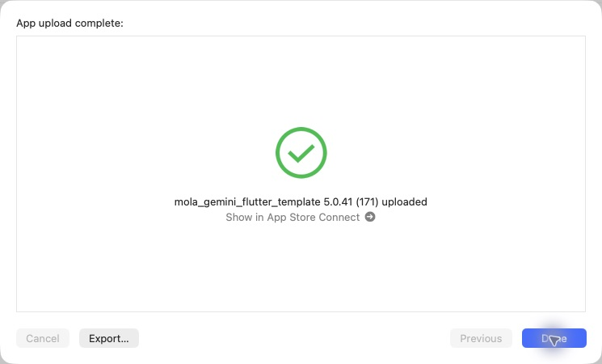

# iOS 5.0.41（171）酒印取得・候補・代替画像

## 変更内容

- 酒印帳に全国の押印済み銘柄を表示。ホームも全国版とし、取得がない場合は山口県を表示する。全国・県別の集計を同じ手描き背景へ収め、押印済みの切り替えは控えめな表示にした。
- ご酒印帳の表紙をタップ・スワイプで開く動作。短いドラッグの取り消し、小画面・動きを減らす設定に対応。
- コピーを「一杯の出会いを、日々の思い出に」に統一。詳細解析に成功した詳細画面の表示と、個人記録の保存成功で初回の酒印を取得し、対象の県・銘柄で演出する。既存記録は静かに継承する。
- 酒印は飲んだ商品数・地図の色・「済」スタンプとは分離。アカウント別・ゲスト別の端末内保存であり、新しい取得コレクションの端末間同期は含まない。
- ラベル検索の既存候補に「マスター」タグを付け、先頭に安定整列。選んだ商品のID・追加候補キーを維持し、種類の文字の二重追記も抑制。
- No Imageを手描きの酒瓶・おちょこと控えめな筆記体へ変更。最近調べたお酒、同銘柄一覧、横並びカード、詳細・地図で画像と文字を切り取らずに表示する。

## 検証とソース

関連89件成功。静的解析エラー0、従来の418件。酒印・地図・候補の並べ替えと確定・代替画像の実デコードを検証した。既存の詳細ページ全体のテストにある6件の失敗と変更前の再現結果は、[酒印取得の検証記録](SAKE_STAMP_ACQUISITION_20261030.md)に記載。

PR87をmainにマージ（365fcf91c18d5f52046523b200380a263ae3600f）。ビルド対象c923ddf9006387f2ac7a23a8256a5070938a3ad2とマージ後mainは同一内容。

production archive成功。アーカイブ内の5.0.41（171）、Bundle ID、非空・展開済みMapsキー、production指定、地図・新しいNo Image画像・汎用イラスト・筆文字フォントとライセンスの同梱ハッシュを確認。AOTバイナリは170と異なる。元チェックアウトの未コミットiOS設定2ファイルはハッシュ一致で保全。秘密値は記録していない。

## Apple送信

CLI exportの既知のNo Accounts / Distribution証明書エラー後、同じ完成済みアーカイブをOrganizerの通常App Store Connect（testing and release）で送信。最初の認証エラーは配信画面を開き直すことで解消し、追加ログインなしで送信できた。

**2026-10-30 12:24 JST、App upload complete / 5.0.41（171）uploadedを確認。** Internal Onlyは使用していない。Appleの処理完了・TestFlightでの利用可能状態は未確認。本番審査には提出していない。今回の配信でAndroid・サーバーの追加配備は行っていない。

[検証・送信データ](data/release_171_ios_20261030.json)

