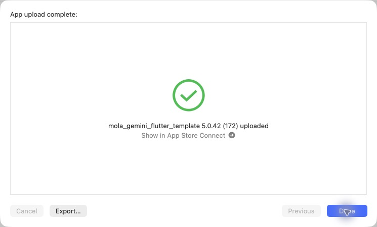

# iOS 5.0.42（172）酒印帳と記録済み商品の表示改善

ホームの酒印帳を先頭9銘柄で取得終了にし、外の全国集計文・ページ送り表示を削除。帳面の右上に総数「現在○銘柄」を表示する。

専用ページは全国を含めて左右へ循環できる。全国の左は沖縄、右は北海道。県の変更・帳面内の矢印・横スライドでは表紙を開く動作を自動再生し、モーション低減設定にも対応する。県選択メニューは画面高40%・最大300ptへ縮小。

銘柄の商品一覧は「済」の付いた商品を先頭にまとめる。確認済み銘柄・正規IDの個人記録を使って後続ページの商品も先に表示し、取得済みカタログと重複除外する。全件の事前取得はせず、記録解除・アカウント切替に追従する。

## 検証・ソース

関連52件成功。全体の静的解析418件、error 0、変更ファイルへの指摘なし。ページをまたぐ記録の先行表示・重複除外・再試行・記録解除・アカウント変更、県の循環、矢印と横スライドの開く動作、小画面・文字倍率1.5の県メニューを検証。

[PR88](https://github.com/MolasoftLLC/mola-ai-flutter-templete/pull/88)をmainへマージ（c4ef17a0ea30e22aa82030f5bd9682f7cf4630e8）。ビルド対象0fb8fc6a9c705ee16cb8936203a9915f9d76afd7とマージ後mainは同一内容。production archive成功、5.0.42（172）、Bundle ID、展開済みの非空Mapsキー、production指定、地図・画像・筆文字フォントとライセンスの同梱ハッシュ、署名を確認。AOTバイナリは171と異なる。元チェックアウトの未コミットiOS設定2ファイルはハッシュ一致で保全。

## Apple送信

CLI exportの既知のNo Accounts / Distribution証明書エラー後、同じ完成済みアーカイブをOrganizerの通常App Store Connect（testing and release）で送信。初回の認証エラーは配信画面を開き直して解消し、追加ログインは不要だった。

**2026-10-30 14:48 JST、App upload complete / 5.0.42（172）uploadedを確認。** Internal Onlyは使用していない。Apple処理完了とTestFlight利用可能状態は未確認。本番審査には提出していない。Android・サーバーの追加配備は行っていない。

[検証・送信データ](data/release_172_ios_20261030.json)

