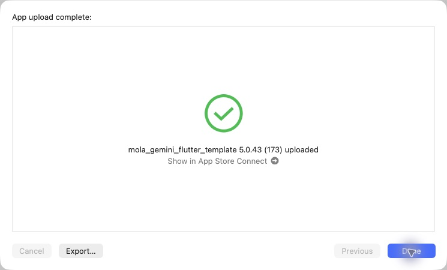

# iOS 5.0.43（173）解析待ちの記録と酒印帳

2026-10-30 16:48 JST、Organizerの通常App Store ConnectでAppleへのアップロード完了を確認。Internal Onlyではない。Appleの処理完了・TestFlight利用可能状態は未確認。本番審査には未提出。

ラベル解析中のYES/NO・フリック回答、任意の星評価、選択した場所を記録フォームの下書きへ引き継ぐ。確認して保存するまで個人記録を変更しない。詳細下部の県別銘柄数・酒印帳への導線、ホームのデモボタン削除も収録。

前の未配信分である、ご酒印のアカウント同期・復元と再送、利用計測の再送修正、実際の紙をめくるアニメーションも含む。対応サーバーは先行して本番反映済み。今回サーバー追加配備・Android配信は行っていない。

## 検証

関連50件と下書き引き継ぎ2件成功。同期32件・紙送り58件は先行検証済み。静的解析は既存418件、新規エラーなし。詳細画面テスト6件の既存失敗は変更前HEADでも再現した。実機の位置権限・店舗検索は未検証。

production archive成功。バージョン・Bundle ID・展開済み非空Mapsキー・production指定・画像／地図／筆文字アセットのハッシュと署名を確認。元チェックアウトの未コミットiOS設定2ファイルは保全。CLI exportのNo Accounts / distribution証明書エラー後、同じ完成済みアーカイブをOrganizerから送信できた。

PR90をmainへマージ。ビルド対象a7611c4とマージ後main f6932b573f35565d353b84bed52ac2f5430d14c0は同一内容。

[検証データ](data/release_173_ios_20261030.json)

