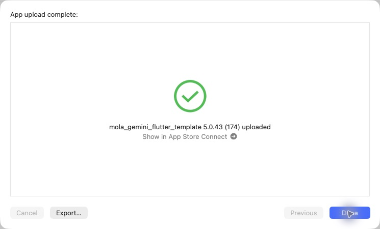

# iOS 5.0.43（174）酒印帳修正

2026-10-30 17:32 JST、通常App Store Connect経由のAppleアップロード完了を確認。TestFlight利用可能状態とApple処理完了は未確認。本番審査には未提出。

- ご酒印帳のページ送り・県変更が配信版で停止する不具合を修正。
- 他人の投稿など通常の詳細閲覧による酒印付与を停止。自分のラベル解析で確定した商品（詳細解析成功済み）と自分の記録保存から取得する。既存酒印は維持。

酒印帳33件・付与11件・詳細画面1件成功。実装を用いたmacOS releaseで順逆ページ送り・スワイプ確定／取消後の操作復帰を確認。静的解析は既存418件。修正版iOS実機検証は未実施。

production archive、展開済みMapsキー、画像・地図・筆文字アセット、署名を検証。元チェックアウトの未コミットiOS設定は保全。CLI exportの既知の認証エラーとOrganizer初回接続失敗後、同一アーカイブを再試行してアップロード成功。

PR91をmainへマージし、ビルド対象4d911cdとマージ後84c630aの内容一致を確認。サーバー変更・Android配信なし。

[検証記録](data/release_174_ios_20261030.json)

