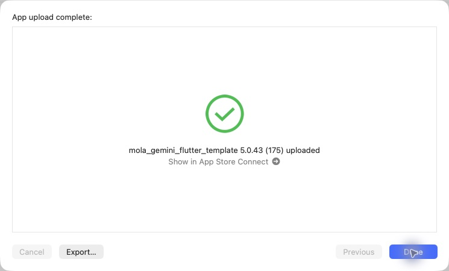

# iOS 5.0.43（175）ナビ・ホーム配置

2026-10-30 17:55 JST、通常App Store Connect経由のAppleアップロード完了を確認。TestFlight利用可能状態・Apple処理完了は未確認。本番審査には未提出。

ボトムナビをホーム／探す／撮る／酒印帳／マイページに整理。探すに既存の各検索を集約し、撮影ボタンを本文にかぶらない配置へ変更。ホームは最近調べたお酒、酒印帳、日本地図、おすすめ、みんなの投稿の順。酒印帳は初回タブ選択時に読み込み、その後は状態を保持。

関連29件のテスト成功。320pt文字1.3倍・390ptの表示確認、静的解析は既存418件。iOS実機確認は未実施。

production archive、Mapsキー、アセット、署名を検証。元チェックアウトのiOS未コミット設定は保全。CLI exportの既知のNo Accountsエラー後、同じアーカイブをOrganizerで送信成功。PR92をmainへマージし、ビルド対象d02f746とマージ後bca11c8の内容一致を確認。サーバー変更・Android配信なし。

[検証記録](data/release_175_ios_20261030.json)

