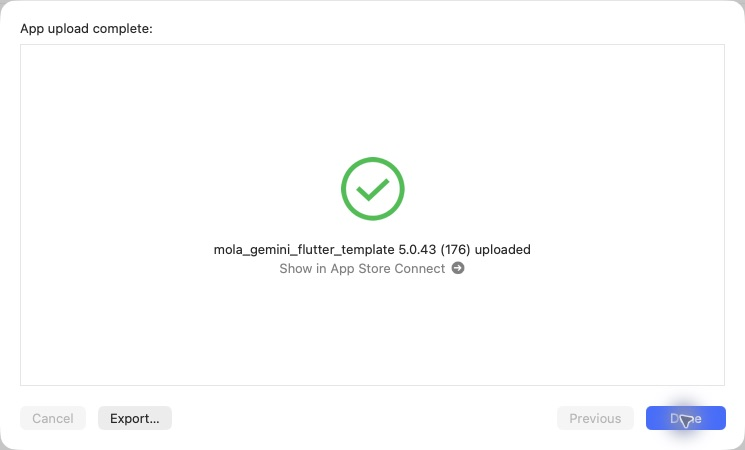

# iOS 5.0.43（176）酒印帳のページ移動

2026-10-30 18:54 JST、通常App Store Connect経由のAppleアップロード完了を確認。Apple処理完了・TestFlight利用可能状態は未確認。本番審査には未提出。

- 県の最後のページから次の都道府県へ移動。
- 最初のページから表紙へ戻る操作と「表紙に戻る」ボタン。
- 表紙を閉じていても、県選択・県移動時はその県のページを開く。
- 戻るときは前のページが左の綴じ目から戻るアニメーション。
- ホームの酒印帳・日本地図の見出しを「最近調べたお酒」と統一。

関連39テスト成功。静的解析は既存418件。戻る途中の描画を画像確認。iOS実機確認は未実施。

production archive、Mapsキー、画像・フォント、署名を検証。元チェックアウトの未コミットiOS設定は保全。CLI exportおよびOrganizer初回の認証エラー後、同一アーカイブで再試行し送信成功。PR93をmainへマージ、ビルド対象f378822とマージ後e273fbeの内容一致を確認。サーバー配備・Android配信なし。直前の銘柄整理は別途本番データ反映済み。

[検証記録](data/release_176_ios_20261030.json)

