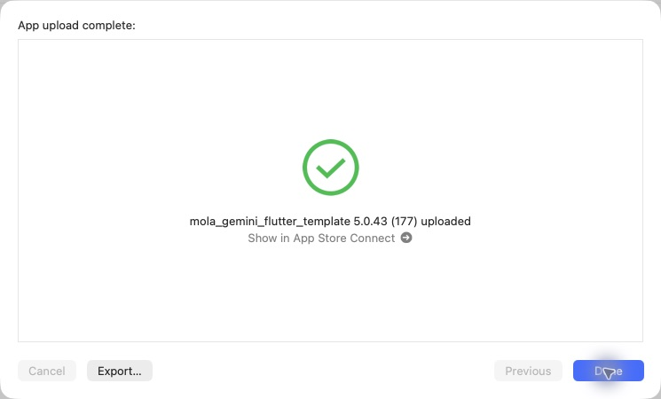

# iOS 5.0.43（177）撮影エラーと記録の改善

2026-10-30、通常App Store Connect経由でAppleアップロード完了を確認。Apple処理完了・TestFlight利用可能状態は未確認。本番審査には未提出。

- 照合待ちにフリック質問を表示し、回答を記録フォームへ引き継ぐ。
- 顔検出を専用ダイアログで案内し、閉じると表ラベル撮影へ戻る。
- 1日の解析上限・解析中・一時的な制限を区別して表示。
- 日本酒以外と明示された候補を確認前に止める。
- 表ラベルの同じ写真で再試行。通信・拒否エラーを裏ラベル案内に変換しない。
- 最近調べたお酒の同一商品は場所や感想のある個人記録を優先して1件表示。元の保存記録は保持。
- 酒印帳は表紙へ戻ったら最初のページへ。県リンクを同銘柄商品の下に配置し、その県の酒印ページを開く。

関連133テスト成功。静的解析422件、エラーなし（前回418件）。production archive・Mapsキー・画像とフォント・署名を確認。実機確認は未実施。CLI exportとOrganizer初回認証エラー後、同一アーカイブの再試行で送信成功。PR94をmainへマージし、ビルド対象39ae03dとマージ後036af26の内容一致を確認。サーバー配備・Android配信なし。

[検証記録](data/release_177_ios_20261030.json)

