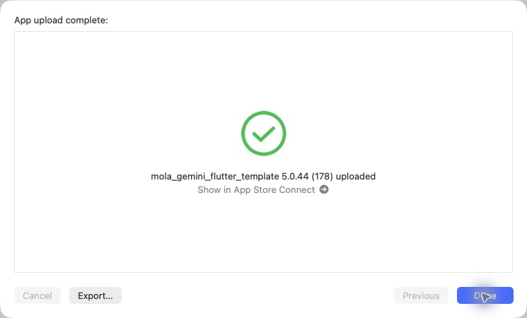

# iOS 5.0.44（178）撮影メニュー・場所入力・ナビゲーション

2026-10-31 14:33 JST、Xcode Organizerで通常App Store Connectへのアップロード完了を確認。Apple処理完了・TestFlight利用可能状態は未確認。本番審査へは未提出。

- ボトムナビをホーム・朱印帳・解析・みんなのマップ・マイページへ変更。探すページを削除。
- 解析は半円メニュー。ラベルとメニューは手描き風アイコン、写真からの入力も可能。
- 照合中は写真が透けるパネルで場所だけを質問。味や飲酒の質問を削除。
- 場所を操作した場合は候補到着後も画面を保持し、ユーザーが候補を見るまで待つ。未操作時は自動表示。
- non_sake応答を専用ダイアログに渡し、確定・保存せず表ラベルへ戻る。顔検出は変更なし。
- 酒印帳は前の県の最終ページへ戻る。ユーザーが対処できない取得失敗件数を非表示。

関連146テスト成功。静的解析422件、エラーなし。production archiveのバージョン・Mapsキー・production指定・署名と地図／画像／筆文字フォントの同梱を確認。実機・実写による本番精度検証は未実施。

PR95をmainへマージ。ビルド対象e840ea8とマージ416c44cの内容一致を確認。CLI exportの既知の署名エラー後、同じアーカイブをOrganizerからアップロード。初回認証エラーは配信画面の開き直しで解消。Internal Onlyは未使用。

[サーバー修正PR62](https://github.com/MolasoftLLC/molasoft-ai-central/pull/62)は最新mainの画像優先判定を保持して統合。2026-10-31 14:34 JST、コミット023802dの本番反映・マイグレーション・公開ヘルスチェック成功を確認。14:35 JSTの追加ヘルス確認もproduction / ok。実行: https://github.com/MolasoftLLC/molasoft-ai-central/actions/runs/41172827404 。ローカルのsake-integrity 227件とresolver 2件成功。

