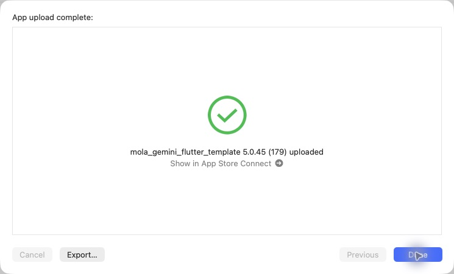
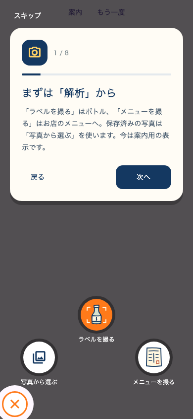

# iOS 5.0.45（179）地図・チュートリアル・撮影導線

## 内容
- 日本酒を旅する: 酒印帳と地図ツールバー・補足文を外し、地図領域を拡大。ピンチ・ドラッグ・県選択と記録一覧は維持。
- みんなのマップ: 登録切替を中央揃え。外部地図にGoogleの店舗IDを渡す。IDなしは店名と座標で検索。
- チュートリアル: 紺・生成りのカード、アイコン、進捗、戻る、スクロール可能な説明へ統一。既存の完了状態は維持。解析ステップでは実際の半円メニューを案内用に展開し、撮影は開始しない。
- 半円メニューのメニュー撮影はカメラを自動起動。写真確認・切り抜きは既存経路。
- ホーム、最近調べたお酒、検索、メニュー、マイページ、保存詳細、商品詳細、同銘柄一覧のスクロールをiOSの上部タップへ接続。隠れたタブやモーダル背面はスクロールしない。

## 検証
関連40テスト成功。展開メニューの画像とカードの非重複、320px・文字拡大、戻る・再表示を追加確認。全体の静的解析422指摘、エラーなし（前版と同数）。
商品詳細テストは32成功・7失敗。変更前のHEADに当該ファイルを戻して同じ32成功・7失敗を再現したため、既存の残件として保持。実機・実写の受け入れ確認は未実施。

## 配信
2026-10-31 15:02 JST、Xcode Organizerの「App upload complete」「5.0.45 (179) uploaded」を確認。通常App Store Connect経路。Apple処理完了・TestFlight利用可能は未確認。本番審査は未提出。

アーカイブの版番号・Mapsキー解決済み・production指定・署名・地図と画像の同梱を確認。CLI exportは既知の署名エラーのため、同じアーカイブをOrganizerから送信。アーカイブ: `build/ios/archive/SAKEPEDIA-5.0.45-179.xcarchive`。

PR96をmainへマージ（7957977）。ビルド元0396068とmainのアプリ・テスト・pubspec内容一致を確認。

## プレビュー
テスト用ホーム配置上での案内。下部ボタンの位置は実アプリの中央配置と異なる。

