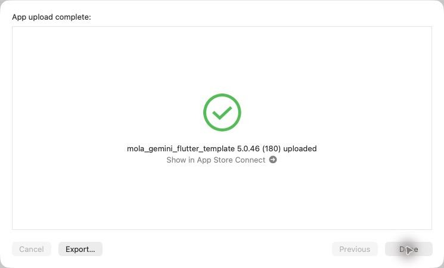

# iOS 5.0.46 (180)

## 変更
- 自分のラベル解析で商品を確定した後、記録フォーム未保存でも銘柄・県の紐づけが取得できれば酒印を付与。飲んだ記録は作らない。既存の記録からの取得、詳細閲覧のみでは取得しない条件、銘柄単位の重複防止を維持。
- 沖縄の挿入地図を拡大し、点の密度と輪郭を調整。
- 照合後の「候補を見る」を黄色の角丸ボタンにし、右側に再生矢印を追加。

## 検証
関連41テスト通過。全体静的解析422指摘（前版と同数、エラーなし）。アーカイブの版番号、Maps設定、地図アセット、署名を確認。実機撮影の受け入れ確認は未実施。

## 配信
2026-10-31、Xcode Organizerの通常App Store Connect配信で「App upload complete」「5.0.46 (180) uploaded」を確認。初回認証エラーは戻って再試行し解消。Apple処理完了・TestFlight利用可能は未確認。本番審査は未提出。

ソース: 631d2fa（mainへ反映済み）
アーカイブ: build/ios/archive/SAKEPEDIA-5.0.46-180.xcarchive

