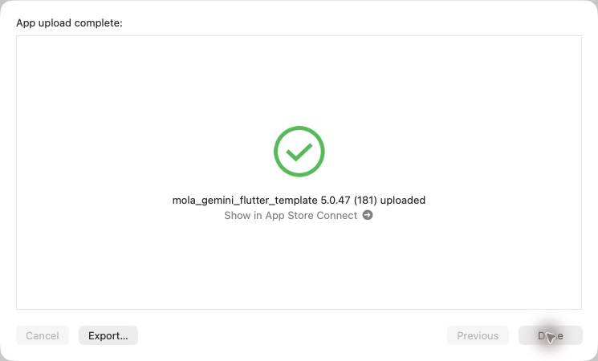
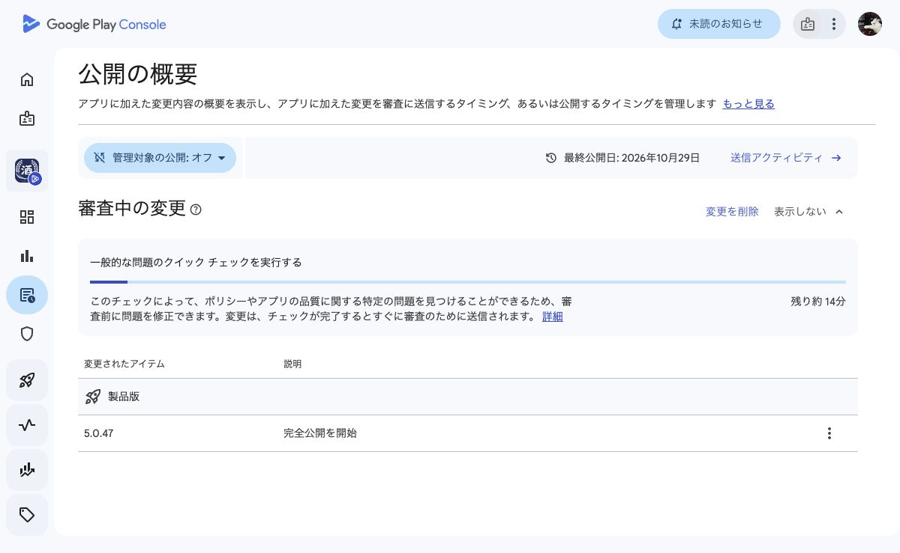

# 5.0.47 (181) iOS・Android配信

## 変更
- 県別の記録一覧の説明を、県に連動する酒印帳バナーに置換。
- ホームの見出し上とセクション間の余白を整理。
- チュートリアルの不要文を削除し、フォーカス枠に有限の拡縮を追加。動きを減らす設定では停止。
- マイページに「あなたの地図」の案内を追加。ログイン時6ステップ、非表示時5ステップ。
- 「お気に入りからお酒診断」へ改名し、「好きなお酒の傾向」内へ移動。
- 月次上限・解析エラーの文言を成功結果と分離。閉じるのみ表示し、保存処理側でも拒否。

## 検証
関連21テスト成功、静的解析423指摘・エラーなし。前の作業で確認した既存のテスト失敗（酒印帳3件、ホームガイド1件）は変更前でも再現。実機での一連の撮影は未検証。
iOS/Androidともproduction指定。版番号・Maps設定・署名を確認。Androidはアップロード後の版番号とSHA-256も一致。
ソース: 1ffe88e（main反映）。

## iOS
Xcode Organizerの通常App Store Connect経路。「App upload complete」「5.0.47 (181) uploaded」を確認。Apple処理完了・TestFlight反映は未確認。本番審査は未提出。
アーカイブ: build/ios/archive/SAKEPEDIA-5.0.47-181.xcarchive

## Android
公開版160を確認後、181をproductionへアップロード・検証・commit。Play Consoleの「審査中の変更」に5.0.47が表示され、クイックチェック中、完了後すぐ審査へ送信される状態を確認（残り約14分表示）。管理対象の公開は既存のオフを維持。審査承認後は自動公開の設定。審査承認・一般公開は未確認。
AAB: build/app/outputs/bundle/release/app-release.aab
APIレシート: /tmp/sakepedia-181-play-receipt.json

