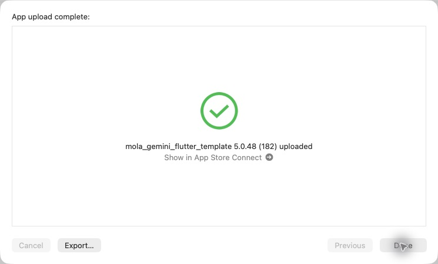
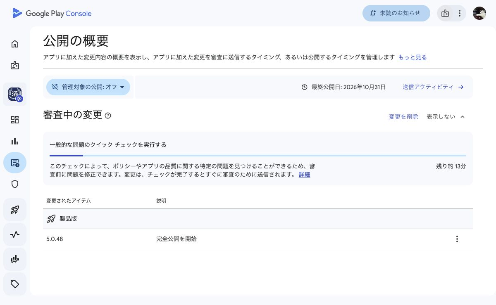
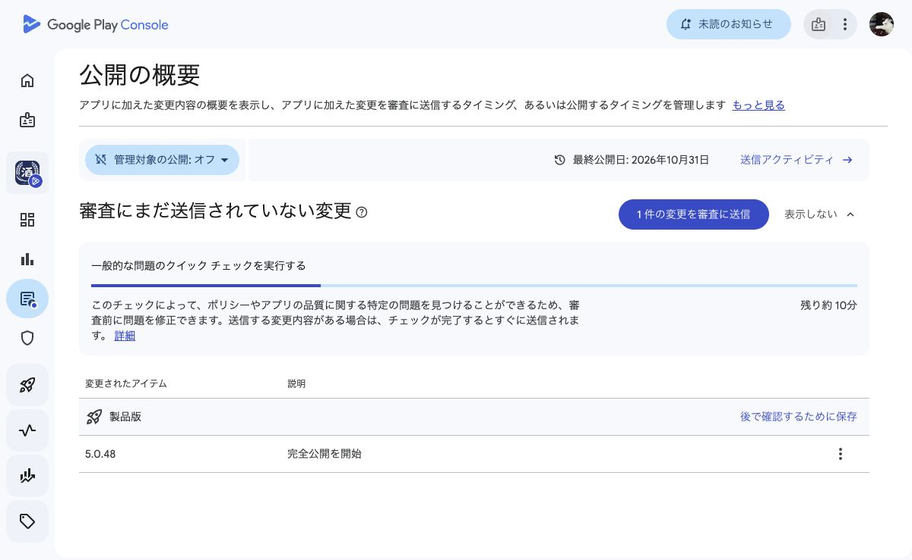

# 5.0.48 (182) メニュー途中表示・初期好み

## 変更
- メニュー画像解析を新API `/api/menu-recognition/extract-progressive` に切り替え。読み取れた商品名と件数を順に表示。
- AI呼び出しは1回。旧APIと画像キャッシュ・利用回数を共有。途中の名前は表示専用とし、保存成功後の完了イベントで結果を確定。
- 初期の好み選択から6軸を設定。未設定・欠落プロフィールをゼロとして扱わず、既存プロフィールを保全。

## 検証
- Flutter関連34テスト成功。静的解析424指摘、エラーなし。
- Backend関連12テストとビルド成功。配備CIの整合性検証・本番反映・マイグレーション・公開ヘルスチェック成功。
- 公開health正常、新APIの未認証リクエストは401。本番HEADと新controllerの配置を確認。
- 本番認証済み実画像での最初の表示時間は未計測。最初のAI出力までの待ち時間そのものが解消する保証はない。
- iOS/Androidともproduction指定、182・5.0.48・Maps設定を確認。Android署名検証、アップロード版番号とSHA-256一致。
- アプリソース: 0169159。Backend: 32f72ccfcc86eba03c5139d76beca527c643bb23。
- 配備: https://github.com/MolasoftLLC/molasoft-ai-central/actions/runs/41413621963

## iOS
Xcode Organizerの通常App Store Connect経路で「App upload complete」「5.0.48 (182) uploaded」を確認。Apple側の処理完了・TestFlight反映は未確認。本番審査は未提出。
アーカイブ: build/ios/archive/SAKEPEDIA-5.0.48-182.xcarchive

## Android
182をproductionへアップロード・validate・commit済み。Play Consoleの「審査中の変更」に5.0.48を確認。クイックチェック完了後に自動審査送信、承認後自動公開の既存設定。審査承認・公開は未確認。
APIレシート: /tmp/sakepedia-182-play-receipt.json

## ユーザー指示による本番審査取り下げ
2026-11-02、ユーザーから本番配信停止の指示。「配信」を本番審査まで含めた解釈は誤りだった。Android 182を審査から取り下げ、Play Consoleの「審査にまだ送信されていない変更」とAPI NOT_SENT_FOR_REVIEWを確認。182は未公開、公開中は181。iOSはアップロードのみで本番審査未提出。サーバーの新APIは反映済み。
今後、このチャットの「配信」はテスト配信として扱う。本番審査・一般公開は明示指示がある場合のみ行う。

