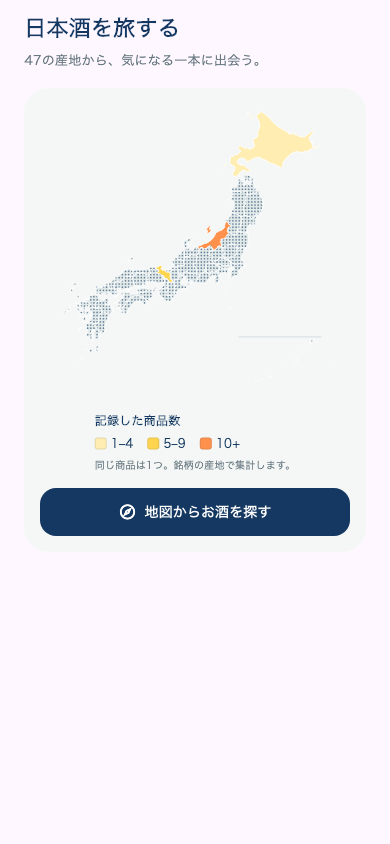
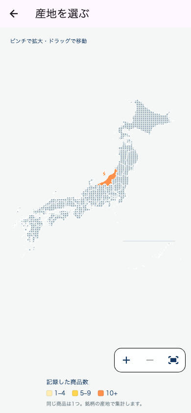

# 記録した商品の産地で日本地図を色付け

2026-10-29の追加依頼に対応。実装・ローカル検証済み、サーバー・iOS・Androidへの配信は未実施。5.0.36+166のまま。

- 県ごとの重複を除いた商品数で、0商品は既存の灰色、1〜4商品は薄い黄色（#FFEDB2）、5〜9商品は黄色（#FFD54F）、10商品以上はオレンジ（#FF914D）。1〜4 / 5〜9の境界は今回の実装上の既定値。
- 対象は現在の端末に読み込まれた自分の「記録」。既存マイページの記録一覧と判定を共通化し、感想・場所・個人タグ・個人の味わい評価・追加写真（画像2枚以上）のいずれかがあるものを対象とする。判定内容は既存一覧から変更していない。保存だけ、AIの商品説明、検索時の写真1枚だけは対象外。
- 同じ商品を何度記録しても1商品。銘柄内の別商品は別々に数え、検証済み重複元IDは正規商品IDへ解決して重複除外する。非ブックマークの記録も対象。
- 色を付ける県は、公開カタログの商品→銘柄→蔵元の所在地。飲んだ場所、記録内の旧県コードや商品名から推測しない。
- ホーム、産地画面、全画面表示で色と凡例を表示。選択中の県は濃紺の輪郭にし、選択だけでオレンジになる表示を廃止。記録編集・削除・ログアウト/利用者切替後は現在のSavedSakeStateから再集計する。
- マスターや産地が未確認の記録は色へ加算せず、未確認の件数を表示。通信失敗は未記録0件と区別し、再試行できる。選択県の商品数も照合完了前・失敗中は確定表示しない。

## データと検証

バックエンドPR56へ公開商品の産地だけを返すPOST `/api/sakes/origins` を追加。送信するのは商品IDのみ、最大200件ずつ。感想・飲んだ場所・公開設定・個人の記録本文は送信しない。公開カタログの照合であり、他人の飲酒記録を返すAPIではない。新しい個人データ保存、DB更新、マイグレーション、シード、AI解析はない。

Flutter関連28件成功。色の境界0/1/4/5/9/10、商品/重複IDの集約、飲んだ場所と産地の区別、記録判定、削除・利用者切替、全画面の色、通信失敗から再試行、201商品以上の分割取得、既存地図/銘柄一覧/ホーム表示を含む。全体analyzeエラー0、既存警告・情報418件。バックエンドbuild成功、隔離DB/コントローラーテスト6件成功。

本番・実機での検証と配信は次の配信依頼時に行う。前の銘柄ブラウザーと一緒にバックエンドを先に配備する。

以下は表示確認用データで、新潟県10商品、京都府5商品、北海道1商品を設定した例。実利用者の履歴は使用していない。

## 配信記録

実装時点の未配信状態は上記のとおり。以後の本番反映・iOS 5.0.37（167）の検証結果は[配信記録](RELEASE_167_IOS_JAPAN_MAP_20261029.md)を参照。
