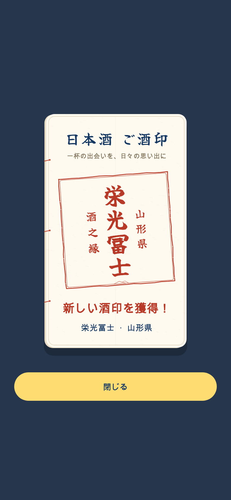

# 酒印の実取得（2026-10-30）

## 取得条件

- 成功した詳細解析を表示した時。説明と有効な6軸プロフィールがあり、pendingでなく、Lens由来はcompletedのみ。キャッシュの存在だけでは成功としない。
- 個人記録の保存成功後。詳細の記録編集シート、旧記録詳細のメモ保存、撮影後の記録保存、詳細ヘッダーの場所保存を対象とする。記録経由は解析完了を必須にしない。
- 銘柄ID・産地・商品IDが確定していること。同じ銘柄は商品が違っても1酒印。別銘柄は別扱い。
- コピーはホーム・専用帳・取得演出とも「一杯の出会いを、日々の思い出に」。実際の対象銘柄・県・銘柄IDの印形で演出し、実取得にはデモの説明・リプレイを出さない。

解析失敗・partial・idle・running、ブックマークだけ、キャンセル、保存失敗、不明な紐づけでは付与しない。既存の個人記録は静かに継承する。新しい酒印は永続化成功後、初回のみ演出する。書込は直列化し、解析詳細と記録が同時完了しても重複しない。画面離脱・アカウント切り替え中の古い応答は除外し、演出中にアカウントが変われば閉じる。

## データの分離と保存範囲

取得した酒印は飲酒記録とは別の端末内コレクション。ログイン中の安定UIDとゲストで保存キーを分離し、取得元・商品ID・銘柄ID・県・観測時刻を保存する。ゲストからアカウントへの自動移転、端末間同期は今回含まない。既存の飲んだ記録は従来の同期・集計を維持する。

ホーム・専用酒印帳・日本酒を旅する内の酒印は、コレクションと既存記録の銘柄IDを重複除外して表示する。地図の飲んだ商品数・色・個人記録・商品一覧の「済」には詳細閲覧による酒印を含めない。酒印の付与で写真・感想・評価・場所・公開設定・保存時刻やブックマークを変更しない。デモは実取得処理を呼ばない。

端末内履歴の読み込みに失敗した場合は未知の履歴を上書きしない。書込失敗では付与を確定しない。酒印取得の失敗が、元の詳細表示や記録保存の失敗扱いにならないようにする。

## 検証

関連97件成功。加えて実際の詳細ページの表示後に付与・再表示では再演出しない経路1件成功。実際の記録編集シートで保存成功後に付与し、保存例外では未付与であることを確認。初回/同銘柄重複/再起動/並行取得/ゲストとアカウント/画面離脱/アカウント変更/旧記録継承/不明産地/不正状態/保存障害/飲酒件数0の維持/3つの酒印表示/モーション低減/小画面を検証。

静的解析はエラー0・既存418件、今回の新規ファイルに指摘なし。

詳細画面の既存スイート全体には6件の失敗がある。変更前888837bの分離チェックアウトでも同じ6件の失敗を再現し、今回の変更による増加ではないことを確認した。キーボード位置・AI候補画面の保存操作・失敗表示・タイムライン共有などの既存のUI期待値が対象。酒印の実取得を検証する追加テストは成功している。

アプリ配信、サーバー配備、本番データ書換は行っていない。

