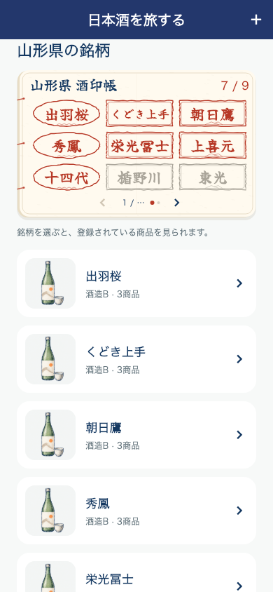
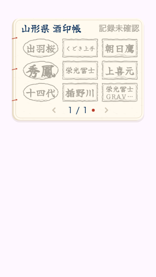

# 日本酒を旅する：9銘柄の酒印帳

承認された[Figma案](https://www.figma.com/design/1LTZtag2amFlIpyTb6K2QX?node-id=1-2)を基に、「○○県の銘柄」直下へ実装。元のFigmaノードは確認用の一枚画像であり、そのUI画像をアプリへ貼らず、実データを使うFlutterウィジェットとして構成した。

## 表示・操作

- 3列×3行の9銘柄ごとに横スワイプ。左右矢印でもページ移動。最終ページは実際の銘柄だけを表示し、残りを無名の余白にする。
- 紙の面は高さ212pt（上下12ptずつの余白を含め236pt）。和紙の繊維・綴じ糸・薄い折り目・朱印のかすれと波/山の飾りをCustomPainterで描く。端末幅320・文字倍率1.5でもカードの高さを増やさない。
- 記録した銘柄は朱色、未記録は薄墨。長い銘柄名は印の中で最大2行に短く収め、長押しと読み上げでは銘柄名全体を確認できる。公式の銘柄ロゴ・実際の蔵訪問証明とは扱わない。
- 印をタップすると既存の銘柄別商品一覧を開く。銘柄名が同じでもIDで区別し、手動で印を付ける処理はない。
- 右上の数字は、そのページにある実銘柄数に対する記録済み銘柄数。未取得のページを0/0と確定しない。全ページ数が未確定の間は分母を「…」にする。

## 記録・通信

朱印は地図で採用済みの「自分の記録」条件と、公開カタログの産地照合結果のbrandIdを用いる。複数商品・繰り返し記録・検証済み統合元が同じ銘柄なら1印。保存だけの商品、未紐付け・産地未確認の記録から推測しない。記録削除・編集・アカウント切替後はSavedSakeStateから再集計。産地照合中・失敗中は「記録未確認」とし、印を確定しない。

銘柄一覧と同じ取得済みページを共用し、独立した全件取得を増やさない。既存の50銘柄単位のAPIを使い、9個区切りで足りなくなるページへ進んだ時だけ追加取得する。50件の初回取得では6ページ目に進む際に続きを取得。失敗時は一覧・印を保持して再読み込みでき、重複リクエストを抑止。DBや個人記録へ書き込みなし。

## 書体

筆文字は[Yuji Syuku（公式リポジトリ）](https://github.com/Kinutafontfactory/Yuji)を同梱。SIL OFL 1.1の原文をアセットへ保持し、既存のライセンス画面にも登録。フォント本体は未改変、約8MiB増。実行時のフォント取得通信なし。[入手元・ハッシュ](data/sake_stamp_font_20261030.json)。

## 検証

- 関連34件成功（地図・ホーム・チュートリアル・フィードバック・既存記録一覧を含む）。描画調整後も酒印帳と集計の8件成功。
- 新規4件：9銘柄のページ、失敗再送と一覧保持、同名でも正しい銘柄IDへ遷移、アカウント切替/削除追従、320×568・文字1.5倍・長名、未確認状態、50件と9個の区切りの不一致時の追加取得。
- 集計テストで同銘柄の別商品・統合元を1印にし、保存だけ・不明産地を除外することを確認。
- 全体静的解析エラー0、既存警告・情報418件、新規指摘なし。フォーマット・差分チェック成功。
- 元のFigma画像の固定の銘柄・印・件数は実利用データとして使わない。画面例は検証用データ。
- 同じPR83へ追加。版番号・サーバー変更・iOS/Android配信なし。

## 配信結果

iOS 5.0.38（168）を2026-10-30 00:59 JSTにAppleへ送信済み。[送信結果と検証](RELEASE_168_IOS_SAKE_STAMP_BOOK_20261030.md)。
