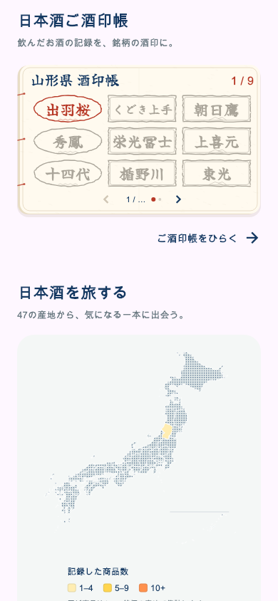
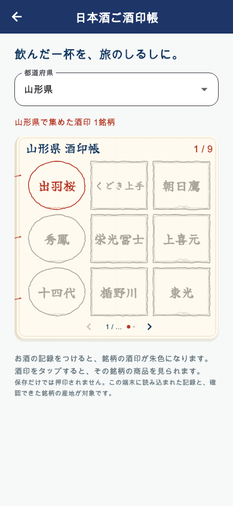
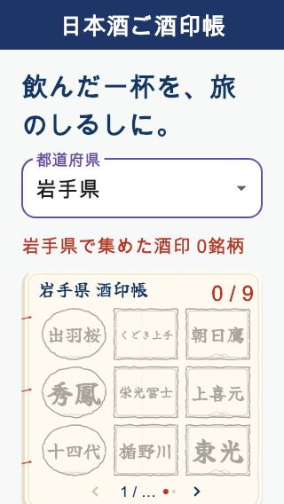

# ホームの「日本酒ご酒印帳」と専用ページ

ホームの「日本酒を旅する」の直前に、「日本酒ご酒印帳」の見出しと既存の和紙・朱印による9銘柄のプレビューを追加。酒印帳全体または「ご酒印帳をひらく →」をタップすると専用ページへ進む。ホームの表示県は記録済み銘柄が最も多い県、同数なら都道府県コード順。確認済み記録がない場合は北海道から表示する。

専用ページでは47都道府県の切り替え、9銘柄ずつのページ送り、酒印から既存の銘柄別商品一覧への遷移ができる。ホームと専用ページは既存のSakeStampBook描画と押印判定を共有し、専用ページのみ酒印を大きく表示する。「日本酒を旅する」の既存表示も維持。

押印は個人の飲んだ記録を既存の共通判定で抽出し、産地照合APIで確認できた銘柄IDを使用する。保存だけ・未確認の産地からは押印しない。現在端末に読み込まれた記録が対象。記録の編集・削除・アカウント切り替えに追従する。商品・記録への書き込みや、API・DB変更はない。

カタログは選択県のみを取得し、続きはページ送り時に取得。銘柄IDで重複を除外する。初回エラーの再読み込み、追加取得エラーでも既存ページの保持、県を素早く切り替えた場合の遅い旧応答の破棄に対応する。

検証：関連38件成功。ホームの配置と紙面タップ→専用ページ→正しい銘柄の商品一覧、初回・追加取得の失敗と再試行、県切替、記録削除、遅延応答、小画面320×568・文字1.5倍を確認。静的解析はエラー0・変更箇所の新規指摘0（既存418件）。通常画面と小画面を実描画で確認。画像は検証用の架空記録。

アプリの版番号変更・配信は未実施。

## iOS配信

iOS 5.0.39（169）を2026-10-30 02:12 JSTにAppleへ送信済み。[送信結果と検証](RELEASE_169_IOS_SAKE_STAMP_HOME_20261030.md)。
