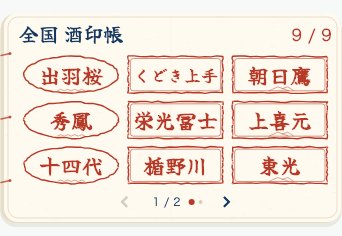
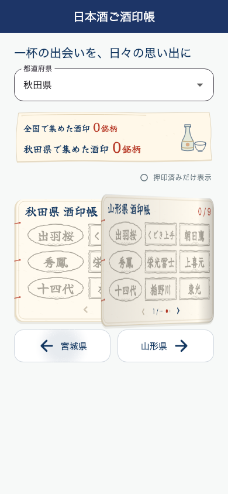

# 酒印帳の紙面をめくる

県の変更や帳面内のページ送りで、表紙を毎回再表示していた。表紙の開封は初回だけに戻し、移動時は実際に表示中の酒印ページをめくって次の紙面を見せる。

- ページ内容の変更前に、描画済みの紙面を取得して手前に保持。次の紙面を下に表示し、元の紙面を綴じ側から回転させて退ける。汎用表紙への置き換えは行わない。
- 次へは左綴じ、戻るは右綴じ。県の左右ボタンも同じ向きで循環移動する。
- 帳面の横ドラッグ量に紙の傾きを追従させ、短いドラッグやキャンセルは元のページへ戻す。十分な距離・フリックで次のページへ確定する。
- 取得済みカタログ・ページ送り・追加読込と再試行、県選択の保存、押印状態を維持。ホームの9件プレビューは静止表示を維持する。
- モーション低減では即座に移動。連続操作・途中破棄時には古い描画を解放する。紙面取得ができない場合も移動を止めない。
- 表紙を一度もアニメーションしない状態で画面を閉じても、終了処理中にアニメーションを初期化しないように修正。

## 検証

関連58件成功（紙面めくり、初回表紙、帳面、酒印取得、済スタンプ、地図、記録集計）。めくる画像が移動前の画像であることを色の異なるページの画素で検証し、表紙が存在しないことも確認。県の逆方向、横ドラッグ追従と取り消し、連続操作、途中破棄、低減設定、データ更新だけでは動かないこと、既存の追加取得・失敗時再試行を検証した。

`flutter analyze`: 全体418件、error 0、変更したDartファイルへの指摘なし。

以下は日本語フォントを読み込んだ実ウィジェットの描画13フレーム。変更後のiOSアップロードは未実施。

