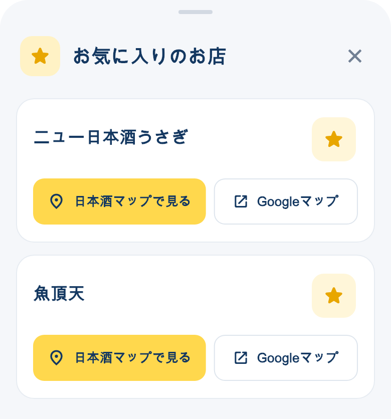

# Venue favorites sheet refinement

Use the existing navy, yellow, white cards and pale page background. Group each venue's name, compact saved star and two map actions in one card. The app map is the primary yellow action; Google Maps is a secondary outline action. Keep the existing save/remove behavior and both map destinations.

Size the sheet to its contents with a maximum height of 78% of the screen, removing the large empty area for short lists. Use one column for actions on narrow screens or larger text. Preserve loading, retry and empty states. Only the sheet uses the compact star; the venue detail header keeps its labeled favorite action.

Validation: 17 favorites UI/controller/storage tests pass. Small width, large text, long venue names, map navigation, star removal and failed-save preservation are covered. Static analysis has no errors. The screenshot renders the real sheet component with sample venue names; it is not a production data capture. No app distribution has been performed.

